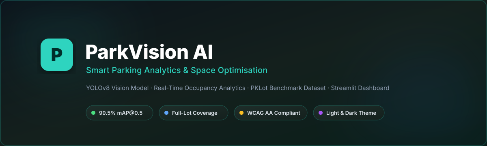
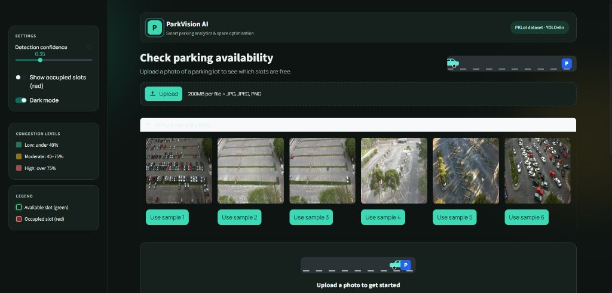
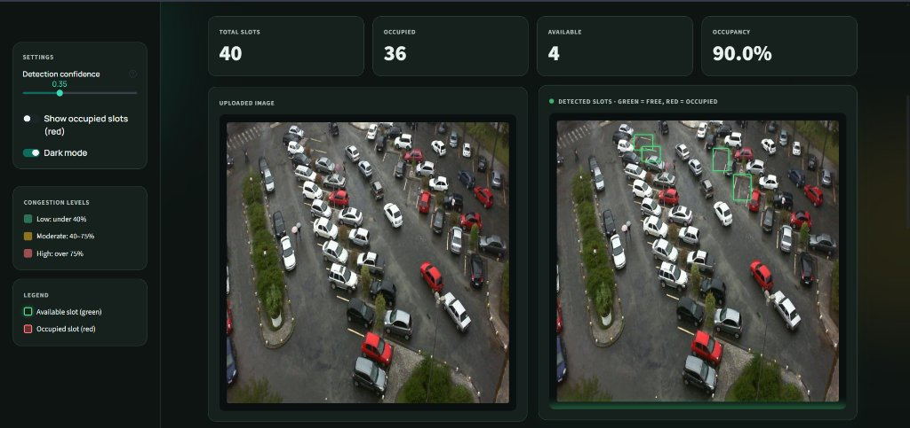
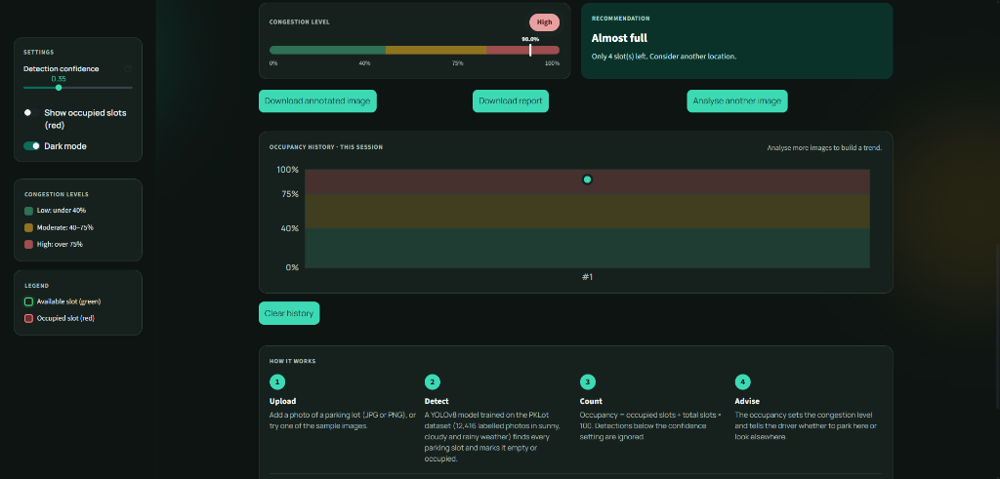
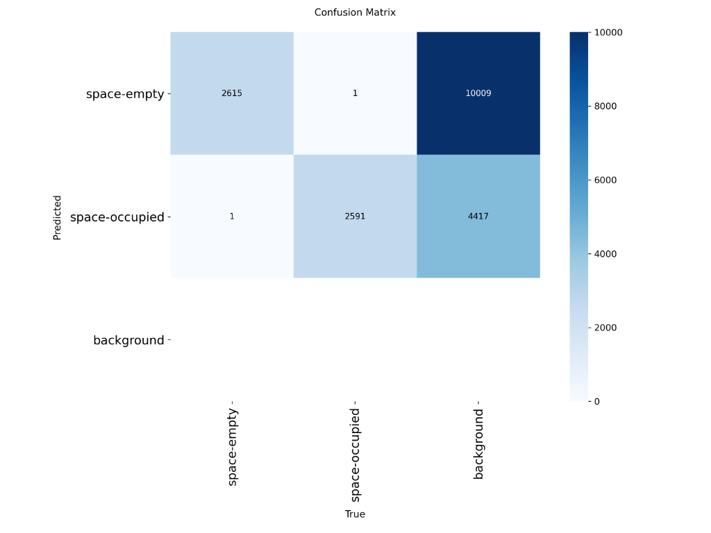
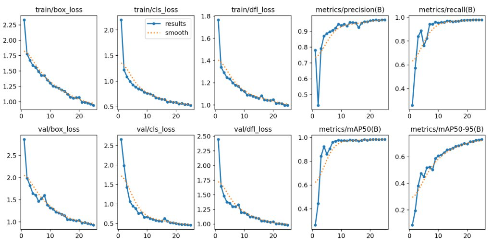

<div align="center">



<br>

[](https://github.com/Ankit4981/IADAI201-1000390--AnkitPradhan)
[](https://ankit4981-parkvisional.streamlit.app/)
[](https://github.com/Ankit4981/IADAI201-1000390--AnkitPradhan)
[](https://github.com/Ankit4981/IADAI201-1000390--AnkitPradhan)

[](https://github.com/Ankit4981/IADAI201-1000390--AnkitPradhan)
[](https://github.com/Ankit4981/IADAI201-1000390--AnkitPradhan)
[](https://github.com/Ankit4981/IADAI201-1000390--AnkitPradhan)
[](https://github.com/Ankit4981/IADAI201-1000390--AnkitPradhan)

**A YOLOv8-powered web app that detects every parking slot in a photo as empty or occupied, then tells the driver whether to park here or look elsewhere.**

[🚦 Overview](#overview) •
[📸 Screenshots](#screenshots) •
[🔧 Under the Hood](#how-it-works) •
[🧰 Features](#features) •
[🏁 Quick Start](#quick-start) •
[📊 Results](#results) •
[🧪 Testing](#testing) •
[🚧 Limitations](#limitations)

</div>

---

## 🪪 Project Card

| | |
|---|---|
| **Student** | Ankit Pradhan |
| **Registration No.** | 1000390 |
| **School** | Viraj International School |
| **Course** | Machine Learning and Deep Learning |
| **CRS** | Artificial Intelligence |
| **Repository** | [Ankit4981/IADAI201-1000390--AnkitPradhan](https://github.com/Ankit4981/IADAI201-1000390--AnkitPradhan) |
| **Live App** | [https://ankit4981-parkvisional.streamlit.app/](https://ankit4981-parkvisional.streamlit.app/) |

---

<a id="overview"></a>
## 🚦 Overview

Drivers in busy cities waste time, fuel and patience searching for a free parking space. **ParkVision AI** analyses a photo of a parking lot and tells the user, slot by slot, which spaces are **occupied** and which are **empty**. It then turns those predictions into useful information: how many slots are free, how full the lot is, and what the driver should do.

| | |
|---|---|
| **Input** | A parking lot image (JPG / PNG) |
| **Output** | Annotated image (🟩 empty, 🟥 occupied), total / occupied / available slots, occupancy %, congestion level, recommendation |

---

<a id="screenshots"></a>
## 📸 Screenshots

### 🏠 Home page
Upload your own photo or pick one of six bundled sample images. The sidebar holds the detection confidence slider, the dark mode toggle, the congestion key and the legend.



### 🔍 Analysis result
The uploaded image sits next to the annotated result. Here the model found **40 slots, 36 occupied, 4 available (90.0 % occupancy)**. Green boxes mark the free slots.



### 🚨 Congestion level, recommendation and session history
At 90 % occupancy the lot is rated **High** and the app advises *"Almost full – consider another location."* The history chart plots every image analysed in the session over the shaded Low / Moderate / High bands. Results can be saved as an annotated image or a text report.



---

<a id="how-it-works"></a>
## 🔧 Under the Hood: How It Works

```
Parking lot image
      │
      ▼
 YOLOv8 detector  ──►  boxes + class (space-empty / space-occupied) + confidence
      │
      ▼
 Counting logic   ──►  total, occupied, available, occupancy %
      │
      ▼
 Insight logic    ──►  congestion level + recommendation
      │
      ▼
 Streamlit dashboard (original image, annotated image, metrics, advice)
```

1. **Detection:** A YOLOv8 model, trained on the PKLot dataset, finds every parking slot in the full image and classifies it as empty or occupied. This is *slot-level* detection, not a single label for the whole image.
2. **Counting:** The number of detected empty and occupied slots gives total, occupied and available slots.
3. **Utilisation:** `occupancy % = occupied / total × 100`. Detections below the confidence setting are ignored.
4. **Congestion level:**

   | Occupancy | Level |
   |---|---|
   | < 40 % | 🟢 Low |
   | 40 – 75 % | 🟡 Moderate |
   | > 75 % | 🔴 High |

5. **Recommendation:**

   | Situation | Message |
   |---|---|
   | No free slots | *"Parking full – try another area."* |
   | High occupancy | *"Almost full – consider another location."* |
   | Moderate | *"Slots available – proceed, but spaces are filling up."* |
   | Low | *"Plenty of slots available – proceed to park."* |

6. **Dashboard:** Streamlit shows the uploaded image next to the annotated result with colour-coded boxes, key metrics and the recommendation.

### 🚘 How it works for a real driver

1. Open the public Streamlit link on a phone or laptop.
2. Upload a photo of a parking lot.
3. Within a few seconds, see which slots are free (green) and taken (red), the occupancy percentage and a clear instruction to park here or look elsewhere.
4. In a real deployment, the upload step would be replaced by a live camera feed, and the same logic would update availability in real time for drivers and city operators.

---

<a id="features"></a>
## 🧰 Features

| Feature | What it does |
|---|---|
| **Upload or sample image** | Upload a JPG/PNG (up to 200 MB), or use one of six bundled photos in `sample_images/` so anyone can test without their own photo. |
| **Animated analysis** | A car drives along a road while the photo is analysed, then slot boxes pop in one by one, empty slots glow, and the numbers count up. |
| **Metrics and congestion** | Total, occupied and available slots, occupancy %, a Low / Moderate / High congestion bar and a recommendation. |
| **Download results** | Save the annotated image (PNG) or a short text report. |
| **Occupancy history chart** | Occupancy across all images analysed in the session, with the Low / Moderate / High bands shaded. |
| **Show occupied slots** | Toggle to draw occupied slots in red as well as free slots in green. |
| **Dark mode** | A sidebar toggle. Both palettes are in `theme.py`, and every text/background pair is checked for readability. |
| **How it works** | An in-app explanation of the model, the occupancy formula and the congestion thresholds. |
| **Slot layout tool** | Mark rows of parking slots on the photo (position, size, columns, rows), save the layout as a `.json` file and load it again for the same camera. |
| **Detection method** | Choose the trained slot model (`best.pt`), or the pretrained `yolov8n.pt` car detector plus the slot layout. A warning appears when very few cars are found. |
| **Detection confidence** | A slider for how sure the model must be before a slot is counted (default 0.35). Lower finds more slots but adds false ones; higher is stricter but can miss slots. |

Motion is switched off automatically for users who have "reduce motion" enabled in their system settings.

---

## 🗂️ Repository Structure

```
IADAI201-1000390--AnkitPradhan/
├── app.py                  # Streamlit dashboard (UI, animations, features)
├── theme.py                # Light and dark colour palettes
├── slots.py                # Slot layout (blocks of slots) and car-to-slot matching
├── check_contrast.py       # Verifies every text/background colour pair (WCAG AA)
├── train_parkvision.py     # Data prep + training + evaluation script
├── .streamlit/
│   └── config.toml         # Base Streamlit theme
├── model/
│   └── best.pt             # Trained YOLOv8 weights
├── yolov8n.pt              # Pretrained COCO weights (car detector for the slot layout method)
├── sample_images/          # Test photos for the sample image buttons
├── parkvision_data/        # Dataset subset (images/ + labels/ + data.yaml)
├── requirements.txt        # Python dependencies
├── packages.txt            # System packages for Streamlit Cloud
├── screenshots/            # Banner and demo screenshots used in this README
└── README.md
```

---

<a id="quick-start"></a>
## 🏁 Quick Start

### 1. Install

```bash
git clone https://github.com/Ankit4981/IADAI201-1000390--AnkitPradhan.git
cd IADAI201-1000390--AnkitPradhan
python -m venv venv
source venv/bin/activate          # Windows: venv\Scripts\activate
pip install -r requirements.txt
```

### 2. Run the app locally

```bash
streamlit run app.py
```

Then open `http://localhost:8501` in your browser.

To verify that all text is readable in both light and dark mode:

```bash
python check_contrast.py
```

It prints the contrast ratio of every colour pair and should end with `ALL PASS`.

### 3. Train the model (recommended: Google Colab with a T4 GPU)

```bash
python train_parkvision.py
```

Before running, set `DATASET_DIR` at the top of the script to the folder that contains the dataset's `train` and `test` folders (default: `pklot`). The script reads the COCO annotations, converts them to YOLO format, builds a 600-image subset, splits it 70/15/15, trains YOLOv8, evaluates on the test split and saves the weights to `model/best.pt`.

On Google Colab, upload the dataset zip to Google Drive and run:

```python
from google.colab import drive
drive.mount('/content/drive')
!unzip -q "/content/drive/MyDrive/pklot.zip" -d /content/pklot
```

### 4. Deploy on Streamlit Cloud

1. Push all files (including `model/best.pt`, `requirements.txt`, `packages.txt`) to GitHub.
2. Go to <https://streamlit.io/cloud> and sign in with GitHub.
3. Click **New app**, choose the repository and branch, set the main file to `app.py`, and click **Deploy**.
4. Copy the public link into the **Live App** fields at the top of this README.

---

## 🔬 Research Findings That Guided the Project

- Slot-level analysis is more useful than classifying a whole image, because drivers need to know *how many* spaces are free, not only whether the lot is "busy".
- Deep-learning methods such as CNN classifiers and YOLO detectors are widely used for parking occupancy and perform well under changing light and weather, provided the training data covers those conditions.
- PKLot is a standard benchmark for this problem because it contains images in sunny, cloudy and rainy conditions, which pushes models to generalise.
- Reviews of surround-view slot detection report that public benchmarks are close to saturated (many studies report about 99 % accuracy on PS2.0) and ask for harder data with varied light and weather (Wong et al., 2023). Weather augmentation can also help: one study reports YOLOv8 AP rising from 0.78 to 0.90 when GAN-made fog, rain and snow images were added (Wei et al., 2025).
- Real-world challenges identified: shadows and lighting changes, partly hidden cars (occlusion), weather variation and different camera angles.

---

## 🗃️ Data Preparation

- **Dataset:** PKLot v2 640 (Roboflow export of the PKLot dataset from Universidade Federal do Paraná, licence CC BY 4.0). It has 12,416 surveillance-camera images of parking lots in sunny, cloudy and rainy weather, with every space labelled *space-empty* or *space-occupied*.
- **Subset:** 600 randomly selected images from the `train` and `test` folders combined (each class appears in well over 100 images).
- **Resizing:** images are already 640×640 (stretched by Roboflow), and YOLO trains at 640.
- **Augmentation:** rotation (±10°), horizontal flip, brightness/saturation/hue adjustment.
- **Split:** 70 % train / 15 % validation / 15 % test.
- **Format conversion:** the dataset ships with COCO annotations (`_annotations.coco.json`). The training script converts every bounding box to YOLO format (class, x-centre, y-centre, width, height, all normalised) and writes `images/{train,val,test}` and `labels/{train,val,test}` plus a `data.yaml`.
- **Classes:** `0 = space-empty`, `1 = space-occupied`.
- **How PKLot is labelled:** every lot image has an XML file with one polygon per parking space and its status. Only valid spaces (marked by yellow or white lines) are labelled, so cars parked elsewhere have no label. The original images are 1280 × 720; the Roboflow export used here is 640 × 640 and stores straight (axis-aligned) boxes, so boxes around tilted spaces can overlap (de Almeida et al., 2015).

---

## ⚙️ Model and Training

| Setting | Value |
|---|---|
| Model | YOLOv8n (pretrained on COCO, fine-tuned) |
| Epochs | 25 |
| Batch size | 16 |
| Image size | 640 |
| Optimiser | Ultralytics default (auto) |
| Augmentation | rotation, flip, HSV / brightness |
| Seed | 42 |
| Training time | about 3 minutes (0.051 h) on a Tesla T4 |
| Model size | 6.5 MB, 3,132,950 parameters, 8.6 GFLOPs |

YOLOv8 was chosen because it detects many objects in a single pass, which suits a lot with dozens of slots, and the nano version is small enough to deploy on free cloud hosting.

---

<a id="results"></a>
## 📊 Results

### Metrics

Evaluated on the held-out **test split (90 images, 5,208 labelled slots)**, which the model never saw during training:

| Metric | Validation (final epoch) | **Test set** |
|---|---|---|
| Precision | 0.972 | **0.996** |
| Recall | 0.979 | **0.998** |
| mAP@0.5 | 0.984 | **0.995** |
| mAP@0.5:0.95 | 0.731 | **0.746** |

**Per-class results on the test set**

| Class | Images | Slots | Precision | Recall | mAP@0.5 | mAP@0.5:0.95 |
|---|---|---|---|---|---|---|
| space-empty | 72 | 2,616 | 0.996 | 0.999 | 0.995 | 0.758 |
| space-occupied | 71 | 2,592 | 0.997 | 0.997 | 0.995 | 0.733 |

Inference takes about 20 ms per image on a Tesla T4, and the fine-tuned model is only 6.5 MB (3.13 M parameters), so it is light enough for free cloud hosting.

### Confusion matrix



The matrix comes from the test run (2,616 empty and 2,592 occupied labelled slots). The two classes are almost never confused with each other: **2,615** empty and **2,591** occupied slots were classified correctly, and only **1** slot of each class was mistaken for the other. The large *background* column (10,009 and 4,417) counts predicted boxes that matched no labelled slot. This is most likely because evaluation keeps very low-confidence boxes and because PKLot labels only valid parking spaces. The app's default confidence of 0.35 removes most of these.

### Training curves



Training and validation losses fall steadily for all 25 epochs and flatten near the end, with no sign of the validation loss turning upward. Precision, recall and mAP@0.5 level off above 0.95, while mAP@0.5:0.95 is still slowly rising. This suggests that more epochs could improve how tightly the boxes fit.

**Summary:** On the test split the fine-tuned YOLOv8n reaches 0.996 precision, 0.998 recall and 0.995 mAP@0.5, and both classes score almost identically, so neither empty nor occupied slots are harder to find. The weaker figure is mAP@0.5:0.95 (0.746), which measures how tightly boxes fit; this is expected because PKLot's tilted spaces are stored as overlapping axis-aligned boxes. These scores are very high partly because PKLot frames come from a few fixed cameras, so photos from a new lot are the more honest check (see Limitations).

---

<a id="testing"></a>
## 🧪 Testing

The system was tested on images not used in training, covering different weather (sunny, cloudy, rainy), lighting and shadows, and different camera angles with partly hidden cars.

| Test image | Condition | Result | Notes |
|---|---|---|---|
| Sample 6 | Rainy, overhead angle, many cars | 40 slots, 36 occupied, 4 free, 90.0 % → **High** | Rated High as expected; the 4 free slots are boxed in green. |
| `` | Sunny | `<ok / issue>` | `<notes>` |
| `` | Different angle | `<ok / issue>` | `<notes>` |

**Improvements made after testing:** `<e.g. added more rainy images, adjusted confidence threshold, retrained>`

---

<a id="limitations"></a>
## 🚧 Limitations and Future Work

- Accuracy depends on camera angle and image quality; lots very different from PKLot may need fine-tuning.
- PKLot frames come from a small number of fixed cameras, and neighbouring frames look very similar. A random split can therefore give optimistic test scores, so testing on photos from a different lot (or your own) is a more honest check.
- Not every car in a PKLot image is labelled, and straight boxes around tilted slots overlap. Some sample images therefore look untidy even when the labels are correct.
- The pretrained `yolov8n.pt` car detector finds very few cars in small, overhead (aerial) views, so it should not be trusted there. The app warns when it finds only a few cars.
- Currently works on single uploaded images; a live video/camera feed would give real-time availability.
- **Future ideas:** peak-hour prediction from occupancy history, navigation to the nearest lot with free slots, a mobile app.

---

## 📚 References

- Almeida, P., Oliveira, L. S., Silva Jr, E., Britto Jr, A., Koerich, A. (2015). *PKLot – A robust dataset for parking lot classification.* Expert Systems with Applications, 42(11):4937-4949.
- PKLot readme (Universidade Federal do Paraná): <https://www.inf.ufpr.br/lesoliveira/download/pklot-readme.pdf>
- PKLot dataset page: <https://web.inf.ufpr.br/vri/databases/parking-lot-database/>
- PKLot v2 640 on Roboflow: <https://public.roboflow.ai/object-detection/pklot>
- Wei, W., Chen, H., Gong, J., Che, K., Ren, W., Zhang, B. (2025). *Real-Time Parking Space Detection Based on Deep Learning and Panoramic Images.* Sensors, 25(20):6449. <https://pmc.ncbi.nlm.nih.gov/articles/PMC12568149/>
- Wong, G. S., Goh, K. O. M., Tee, C., Md. Sabri, A. Q. (2023). *Review of Vision-Based Deep Learning Parking Slot Detection on Surround View Images.* Sensors, 23(15):6869. <https://doi.org/10.3390/s23156869>
- Bharath K. *Car-Parking-Detection* (GitHub, MIT licence). Idea of marking parking-slot positions by hand on a fixed view: <https://github.com/8harath/Car-Parking-Detection>
- Ultralytics YOLO documentation: <https://docs.ultralytics.com/>
- Streamlit documentation: <https://docs.streamlit.io>
- OpenCV documentation: <https://docs.opencv.org/4.x/>

---

## 🔐 Access

GitHub access shared with `ai.assignments@wacpinternational.org` as required by the assessment brief.

---

<div align="center">

🚗 **ParkVision AI** · Ankit Pradhan · Viraj International School 🅿️

Built with YOLOv8, Streamlit and the PKLot dataset · Dataset © Universidade Federal do Paraná, CC BY 4.0

[⬆ Back to top](#)

</div>
